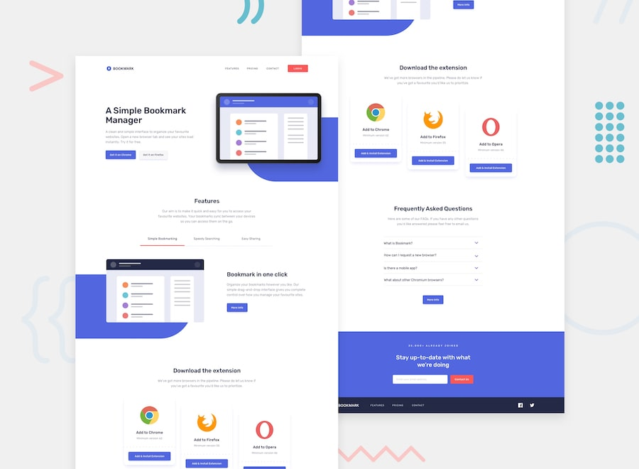

# Frontend Mentor - Bookmark landing page solution

This is my solution to the [Bookmark landing page challenge on Frontend Mentor](https://www.frontendmentor.io/challenges/bookmark-landing-page-5d0b588a9edda32581d29158). The project is built with semantic HTML, responsive CSS, and vanilla JavaScript.

## Table of contents

- [Overview](#overview)
  - [The challenge](#the-challenge)
  - [Screenshot](#screenshot)
  - [Links](#links)
- [Built with](#built-with)
- [Features](#features)
- [What I learned](#what-i-learned)
- [Running locally](#running-locally)
- [Acknowledgments](#acknowledgments)

## Overview

### The challenge

Users should be able to:

- View an optimal layout on mobile and desktop screens
- See hover and active states for interactive elements
- Open and close the mobile navigation
- Switch between feature tabs
- Expand and collapse FAQ items
- Submit the newsletter form
- Receive a clear validation error for empty or incorrectly formatted email addresses

### Screenshot



### Links

- Repository: [GitHub](https://github.com/developer-ruben/Bookmark-landing-page)
- Challenge: [Frontend Mentor](https://www.frontendmentor.io/challenges/bookmark-landing-page-5d0b588a9edda32581d29158)

## Built with

- Semantic HTML5
- CSS custom properties
- CSS Grid and Flexbox
- Mobile-first responsive layout
- Vanilla JavaScript
- Accessible tab and navigation patterns
- Google Fonts

## Features

- Responsive hero, feature, extension, FAQ, newsletter, and footer sections
- Mobile navigation overlay with dynamic logo and menu icons
- Interactive feature tabs that translate the selected content panel
- Accordion-style FAQ items with `aria-expanded` state updates
- Newsletter email validation with a visible error state
- Keyboard-friendly controls and screen-reader utility text

## What I learned

This project reinforced the value of building an interaction in distinct layers:

- Semantic HTML creates a reliable structure before styling begins
- CSS custom properties make typography and spacing rules easier to maintain
- JavaScript state should stay synchronized with accessible attributes such as `aria-expanded` and `aria-selected`
- Responsive components are easier to reason about when each layout is tested from the smallest breakpoint upward
- Form validation should give users immediate, understandable feedback

One improvement I would make in a future iteration is to replace the current email submission flow with a real newsletter API or a more explicit success state.

## Running locally

No build step or dependency installation is required.

1. Clone the repository.
2. Open `index.html` directly in a browser, or serve the directory with a local HTTP server.

For example, using Python:

```bash
python3 -m http.server
```

Then visit `http://localhost:8000`.

## Acknowledgments

- Challenge and design assets provided by [Frontend Mentor](https://www.frontendmentor.io)
